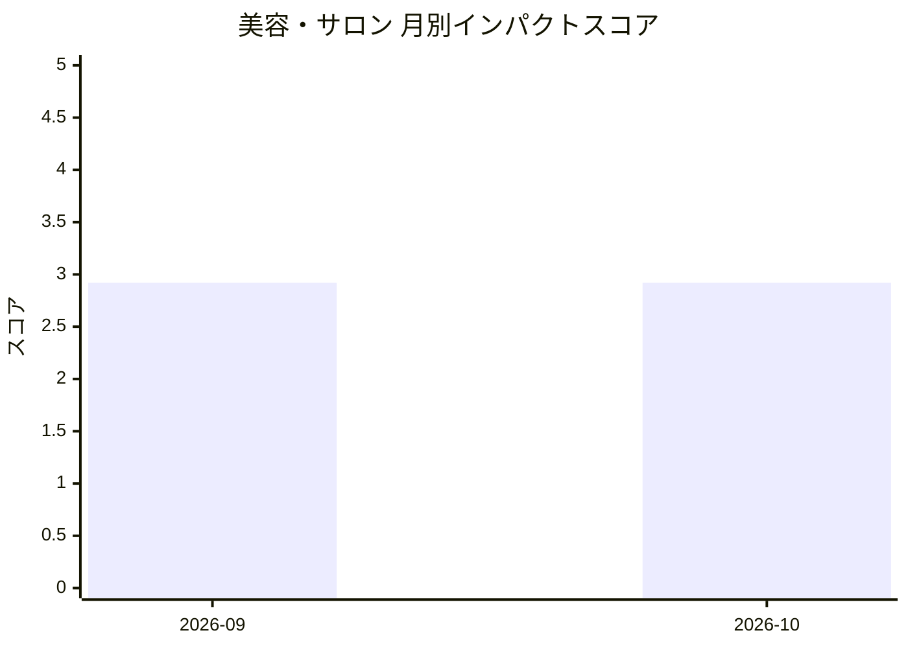

# 美容・サロン — AI活用インパクトスコア

> 最終更新: 2026-10-24 23:55 UTC | 関連記事数: 4件

## AIインパクト概要

# 美容・サロンへのAIインパクト分析

## 技術トレンドの影響

Metaの「Muse」のようなパーソナルAIエージェントは、美容サロンの予約代行や顧客とのコミュニケーション自動化を実現し、電話やメール対応の業務負担を大幅に削減できます。Claude Codeなどのノーコード開発ツール(プログラミング不要でシステムを構築できる技術)を活用すれば、個人経営のサロンでも予約管理や顧客データベースなど独自のシステムを低コストで構築可能になります。

AIが顧客の過去の施術履歴や好みを学習することで、パーソナライズされた提案やリマインド送信が自動化され、リピート率向上や予約忘れの削減に貢献するでしょう。一方で、人間ならではのカウンセリングや技術提供という本質的な価値をより重視したサービス設計が、競合との差別化に重要になります。

## 月別インパクトスコア推移

| 月 | 関連記事数 | 平均スコア |
|-----|-----------|-----------|
| 2026-10 | 2件 | 2.92 |
| 2026-09 | 2件 | 2.92 |

## 注目記事 TOP3

### 1. [Meta、パーソナルAIエージェント「Muse」発表　メール送信や買い物も代行（まずは米国で無料提供開始）](https://www.itmedia.co.jp/news/article/2609/09/2000001294/)
**3.0 ★★★☆☆** | ITmedia AI | 2026-09-08

（スコアリングAPIエラー）

### 2. [「予約機能を作って」は失敗する。Claude Codeへの指示は「やらないこと」と判断基準を渡す(Larave](https://zenn.dev/mugen_web/articles/claude-code-instruction-granularity)
**3.0 ★★★☆☆** | Zenn AI トピック | 2026-10-08

（スコアリングAPIエラー）

### 3. [What will Apple’s John Ternus era look like?](https://techcrunch.com/video/what-will-apples-john-ternus-era-look-like/)
**2.9 ★★☆☆☆** | TechCrunch AI | 2026-09-04

（スコアリングAPIエラー）

---
*本ページは ai-research システムにより自動生成されました。*