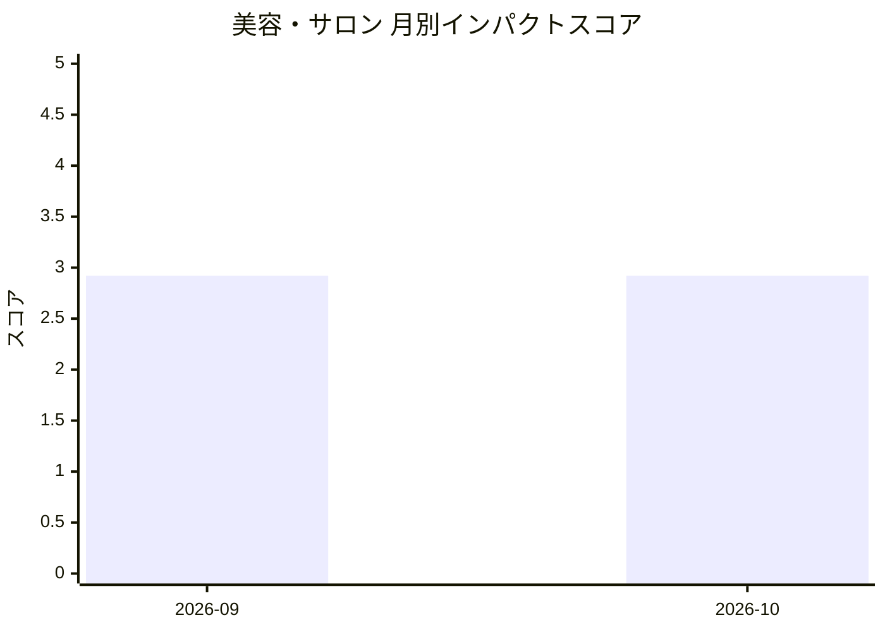

# 美容・サロン — AI活用インパクトスコア

> 最終更新: 2026-11-08 01:00 UTC | 関連記事数: 4件

## AIインパクト概要

# 美容・サロンへのAIインパクト分析

## 主要な影響

パーソナルAIエージェント「Muse」のような技術は、**サロン予約の自動化や顧客対応の効率化**を加速させます。顧客がAIアシスタントに「来週美容院を予約して」と依頼するだけで、希望のメニューや時間帯を考慮した予約が完了する時代が到来します。

サロン側では、Claude Codeのような**開発支援AI**を活用することで、専門的なプログラミング知識がなくても予約システムやカスタマー管理ツールを自社で構築・改善できるようになり、**中小規模サロンのDX（デジタル変革）投資のハードルが大幅に下がる**でしょう。

一方で、AIによる予約自動化が普及すると、サロン間の競争は「AIエージェントに選ばれる存在」になることが重要となり、**オンライン上での評価管理やデータ最適化**が新たな差別化ポイントになります。

## 月別インパクトスコア推移

| 月 | 関連記事数 | 平均スコア |
|-----|-----------|-----------|
| 2026-10 | 2件 | 2.92 |
| 2026-09 | 2件 | 2.92 |

## 注目記事 TOP3

### 1. [Meta、パーソナルAIエージェント「Muse」発表　メール送信や買い物も代行（まずは米国で無料提供開始）](https://www.itmedia.co.jp/news/article/2609/09/2000001294/)
**3.0 ★★★☆☆** | ITmedia AI | 2026-09-08

（スコアリングAPIエラー）

### 2. [「予約機能を作って」は失敗する。Claude Codeへの指示は「やらないこと」と判断基準を渡す(Larave](https://zenn.dev/mugen_web/articles/claude-code-instruction-granularity)
**3.0 ★★★☆☆** | Zenn AI トピック | 2026-10-08

（スコアリングAPIエラー）

### 3. [What will Apple’s John Ternus era look like?](https://techcrunch.com/video/what-will-apples-john-ternus-era-look-like/)
**2.9 ★★☆☆☆** | TechCrunch AI | 2026-09-04

（スコアリングAPIエラー）

---
*本ページは ai-research システムにより自動生成されました。*