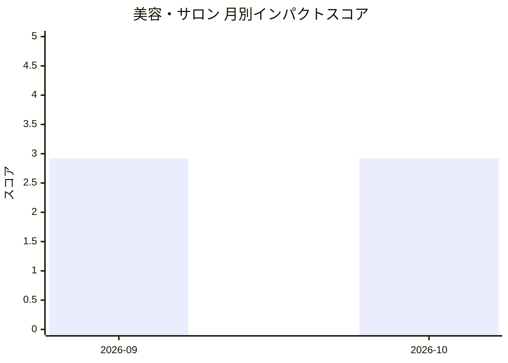

# 美容・サロン — AI活用インパクトスコア

> 最終更新: 2026-11-15 01:29 UTC | 関連記事数: 4件

## AIインパクト概要

# 美容・サロン業界へのAI技術のインパクト

MetaのパーソナルAIエージェント「Muse」のような予約代行機能を持つAIは、顧客が自然言語で「来週の土曜日にカット予約して」と依頼するだけで自動的にサロン予約が完了する時代をもたらします。サロン側も、Claude Codeのような開発支援AIを活用し「キャンセル待ちリストの自動管理」など具体的な業務課題を解決するシステムを、専門知識なしで構築できるようになります。

これにより、電話応対や予約管理に費やしていた時間が大幅に削減され、スタッフは顧客とのカウンセリングや技術向上により多くの時間を割けるようになるでしょう。一方で、AIエージェント経由での予約が主流になると、顧客との直接的な接点が減少するため、パーソナライズされた提案力やリピーター獲得戦略の重要性が一層高まると予想されます。

## 月別インパクトスコア推移

| 月 | 関連記事数 | 平均スコア |
|-----|-----------|-----------|
| 2026-10 | 2件 | 2.92 |
| 2026-09 | 2件 | 2.92 |

## 注目記事 TOP3

### 1. [Meta、パーソナルAIエージェント「Muse」発表　メール送信や買い物も代行（まずは米国で無料提供開始）](https://www.itmedia.co.jp/news/article/2609/09/2000001294/)
**3.0 ★★★☆☆** | ITmedia AI | 2026-09-08

（スコアリングAPIエラー）

### 2. [「予約機能を作って」は失敗する。Claude Codeへの指示は「やらないこと」と判断基準を渡す(Larave](https://zenn.dev/mugen_web/articles/claude-code-instruction-granularity)
**3.0 ★★★☆☆** | Zenn AI トピック | 2026-10-08

（スコアリングAPIエラー）

### 3. [What will Apple’s John Ternus era look like?](https://techcrunch.com/video/what-will-apples-john-ternus-era-look-like/)
**2.9 ★★☆☆☆** | TechCrunch AI | 2026-09-04

（スコアリングAPIエラー）

---
*本ページは ai-research システムにより自動生成されました。*