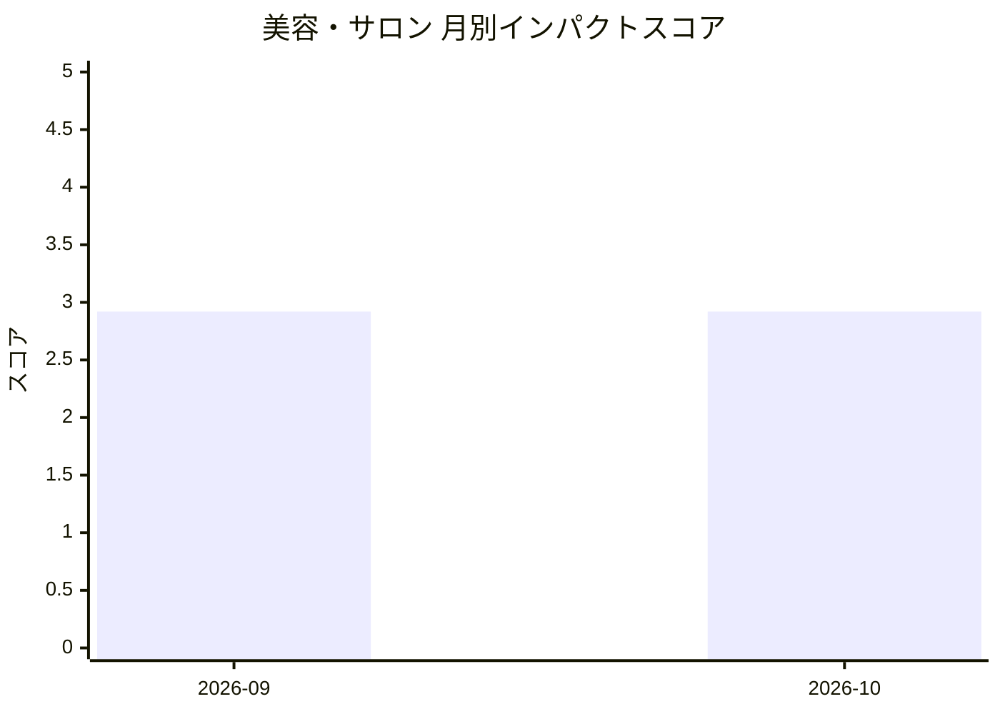

# 美容・サロン — AI活用インパクトスコア

> 最終更新: 2026-11-01 00:37 UTC | 関連記事数: 4件

## AIインパクト概要

# 美容・サロンへのAIインパクト分析

## 主要な影響

MetaのパーソナルAIエージェント「Muse」のような技術は、美容サロンの**予約管理を自動化**し、顧客が自然言語でAIに依頼するだけで希望の施術や時間帯の予約が完了する仕組みを実現します。Claude Codeのような開発支援ツールを活用することで、サロン独自の予約システムや顧客管理システムを低コストで構築でき、小規模サロンでもデジタル化が進むでしょう。さらに、AIエージェントが顧客の過去の施術履歴や好みを学習し、パーソナライズされた美容提案や製品レコメンデーション(おすすめ商品の提示)を自動的に行うことで、顧客体験の向上とリピート率の改善が期待できます。これにより、スタッフは接客や技術提供により集中でき、サロン運営の効率化と売上向上の両立が可能になります。

## 月別インパクトスコア推移

| 月 | 関連記事数 | 平均スコア |
|-----|-----------|-----------|
| 2026-10 | 2件 | 2.92 |
| 2026-09 | 2件 | 2.92 |

## 注目記事 TOP3

### 1. [Meta、パーソナルAIエージェント「Muse」発表　メール送信や買い物も代行（まずは米国で無料提供開始）](https://www.itmedia.co.jp/news/article/2609/09/2000001294/)
**3.0 ★★★☆☆** | ITmedia AI | 2026-09-08

（スコアリングAPIエラー）

### 2. [「予約機能を作って」は失敗する。Claude Codeへの指示は「やらないこと」と判断基準を渡す(Larave](https://zenn.dev/mugen_web/articles/claude-code-instruction-granularity)
**3.0 ★★★☆☆** | Zenn AI トピック | 2026-10-08

（スコアリングAPIエラー）

### 3. [What will Apple’s John Ternus era look like?](https://techcrunch.com/video/what-will-apples-john-ternus-era-look-like/)
**2.9 ★★☆☆☆** | TechCrunch AI | 2026-09-04

（スコアリングAPIエラー）

---
*本ページは ai-research システムにより自動生成されました。*