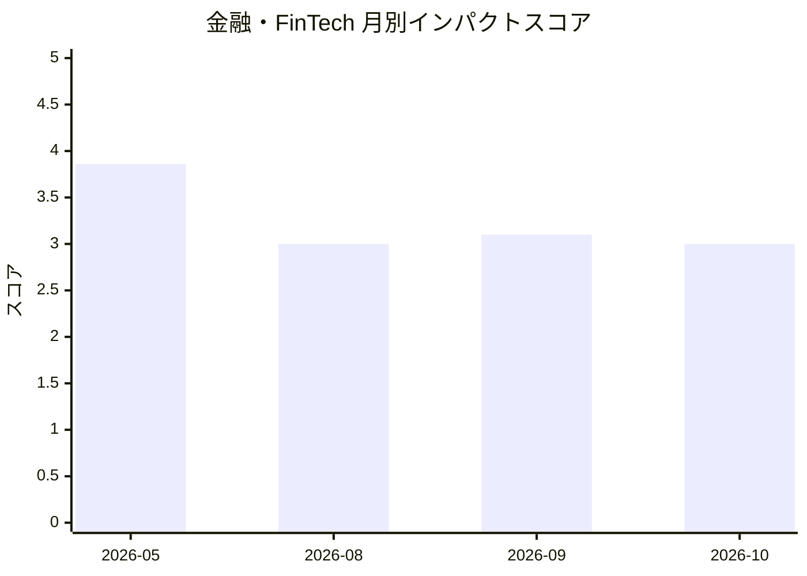

# 金融・FinTech — AI活用インパクトスコア

> 最終更新: 2026-11-01 00:37 UTC | 関連記事数: 8件

## AIインパクト概要

# 金融・FinTechへのAI技術のインパクト

金融業界では、顧客接点のAI化が急速に進展しています。三菱UFJフィナンシャル・グループとGoogleの協業事例が示すように、商品選択から決済までの一連の顧客体験をAIが支援する統合型サービスが実現しつつあり、金融サービスの利便性が大きく向上します。

同時に、Parloaのような対話型AIエージェント(自然な会話でサービスを提供するAIシステム)の発展により、顧客サポートの質と効率が飛躍的に改善され、24時間365日の高品質なサービス提供が可能になっています。

また、Microsoft 365 Copilotの事例から示唆されるように、金融機関内部でも生成AIツールの活用が進んでおり、業務効率化には段階的な導入と現場主導の活用促進が成功の鍵となることが明らかになっています。

## 月別インパクトスコア推移

| 月 | 関連記事数 | 平均スコア |
|-----|-----------|-----------|
| 2026-10 | 1件 | 3.00 |
| 2026-09 | 3件 | 3.10 |
| 2026-08 | 1件 | 3.00 |
| 2026-05 | 3件 | 3.86 |

## 注目記事 TOP3

### 1. [Parloa builds service agents customers want to talk to](https://openai.com/index/parloa)
**4.7 ★★★★☆** | OpenAI Blog | 2026-05-07

ParloaがOpenAIのモデルを活用し、音声駆動型のAIカスタマーサービスエージェントを開発。企業が設計・シミュレーション・リアルタイム配置を実現する。

`音声AI` `カスタマーサービス` `AIエージェント` `OpenAI`

### 2. [M365 Copilotの定着に万全なサポートは逆効果？　社内利用率95％の企業が実践する5つの鉄則](https://www.itmedia.co.jp/enterprise/articles/2605/07/news113.html)
**3.5 ★★★☆☆** | ITmedia AI | 2026-05-07

Microsoft 365 Copilot導入企業の95％利用率達成事例から、組織への定着を促進する5つの鉄則を紹介。過度なサポートが却って利用阻害になる実態と運用改善のポイントを解説。

`M365 Copilot` `導入事例` `組織変革` `利用定着`

### 3. [商品選びから決済までをAIでお助け──MUFGがGoogleとタッグで実現目指す　Google Cloud上に](https://www.itmedia.co.jp/news/articles/2605/07/news110.html)
**3.4 ★★★☆☆** | ITmedia AI | 2026-05-07

MUFGとGoogleが連携し、Google Cloud上に商品選びから決済までをサポートするAIシステムを構築。金融機関が顧客体験向上を目指す取り組み。

`MUFG` `Google Cloud` `金融AI` `カスタマージャーニー`

---
*本ページは ai-research システムにより自動生成されました。*