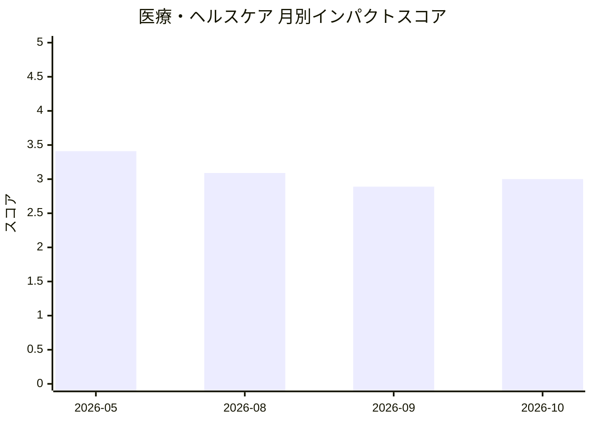

# 医療・ヘルスケア — AI活用インパクトスコア

> 最終更新: 2026-11-15 01:29 UTC | 関連記事数: 12件

## AIインパクト概要

# 医療・ヘルスケア分野へのAI影響分析

## 主要なインパクト

医療・ヘルスケア分野では、**臨床医が監督するAIシステム**の開発が加速しており、仮想言語療法士のように専門医療サービスへのアクセスを拡大する動きが見られます。大規模言語モデル(LLM:膨大なテキストデータで学習した高度な文章生成AI)が診断支援や治療計画の立案に活用され始めており、医師の意思決定を補助する「協働型AI」として位置づけられています。

また、複数のデータソース(画像、検査値、カルテなど)を統合的に分析する**マルチモーダルAI技術**により、より包括的で正確な診断が可能になりつつあります。これらの技術は医療の質を向上させる一方で、AI判断の透明性確保や医師との責任分担など、倫理的・法的課題への対応が今後の鍵となるでしょう。

## 月別インパクトスコア推移

| 月 | 関連記事数 | 平均スコア |
|-----|-----------|-----------|
| 2026-10 | 2件 | 3.00 |
| 2026-09 | 4件 | 2.89 |
| 2026-08 | 5件 | 3.09 |
| 2026-05 | 1件 | 3.41 |

## 注目記事 TOP3

### 1. [Virtual Speech Therapist: A Clinician-in-the-Loop AI Sp](https://arxiv.org/abs/2605.01101)
**3.4 ★★★☆☆** | arXiv cs.AI | 2026-05-06

（APIキー未設定のためモックスコアを使用）

### 2. [Standalone LLM and a Pre-specified Agentic Pipeline for](https://arxiv.org/abs/2608.26109)
**3.3 ★★★☆☆** | arXiv cs.AI | 2026-08-28

（スコアリングAPIエラー）

### 3. [Methodological and Conceptual Framework for 5D Multi-Ta](https://arxiv.org/abs/2608.26149)
**3.3 ★★★☆☆** | arXiv cs.AI | 2026-08-29

（スコアリングAPIエラー）

---
*本ページは ai-research システムにより自動生成されました。*