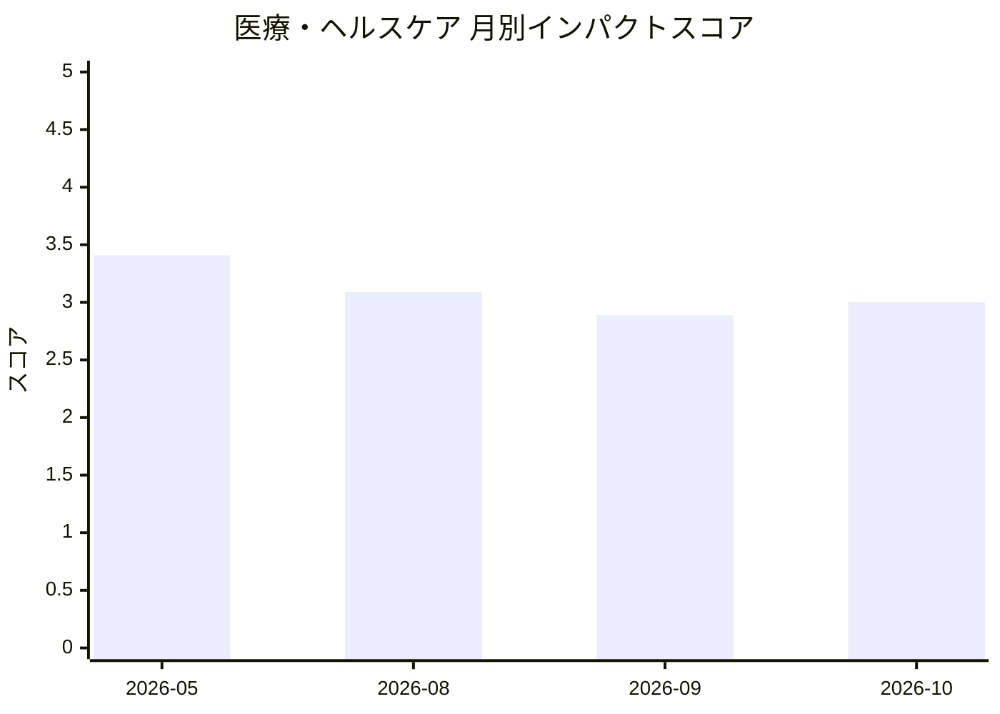

# 医療・ヘルスケア — AI活用インパクトスコア

> 最終更新: 2026-11-08 01:00 UTC | 関連記事数: 12件

## AIインパクト概要

# 医療・ヘルスケアへのAIインパクト分析

## 主要なトレンド

医療・ヘルスケア分野では、**臨床医との協働を前提としたAIシステム**の開発が進んでいます。特に仮想言語療法士のような専門的な治療支援AIでは、医療従事者が診断や治療方針を最終的に確認する「Clinician-in-the-Loop」(臨床医が判断プロセスに関与し続ける仕組み)のアプローチが採用されています。

また、LLM(大規模言語モデル:膨大なテキストデータで学習したAI)を活用した自律的なエージェントシステム(自動的に複数のタスクを実行するAI)により、診断支援や患者対応の効率化が図られています。さらに、5D(五次元:時間軸を含む4次元データにさらに複数の生理学的パラメータを加えた多次元データ)マルチタスク解析フレームワークの登場により、複雑な医療データを統合的に分析し、より精度の高い予測や個別化医療が可能になりつつあります。

これらの技術は医療従事者の負担軽減と診断精度の向上を両立させ、特に専門医が不足している分野

## 月別インパクトスコア推移

| 月 | 関連記事数 | 平均スコア |
|-----|-----------|-----------|
| 2026-10 | 2件 | 3.00 |
| 2026-09 | 4件 | 2.89 |
| 2026-08 | 5件 | 3.09 |
| 2026-05 | 1件 | 3.41 |

## 注目記事 TOP3

### 1. [Virtual Speech Therapist: A Clinician-in-the-Loop AI Sp](https://arxiv.org/abs/2605.01101)
**3.4 ★★★☆☆** | arXiv cs.AI | 2026-05-06

（APIキー未設定のためモックスコアを使用）

### 2. [Standalone LLM and a Pre-specified Agentic Pipeline for](https://arxiv.org/abs/2608.26109)
**3.3 ★★★☆☆** | arXiv cs.AI | 2026-08-28

（スコアリングAPIエラー）

### 3. [Methodological and Conceptual Framework for 5D Multi-Ta](https://arxiv.org/abs/2608.26149)
**3.3 ★★★☆☆** | arXiv cs.AI | 2026-08-29

（スコアリングAPIエラー）

---
*本ページは ai-research システムにより自動生成されました。*