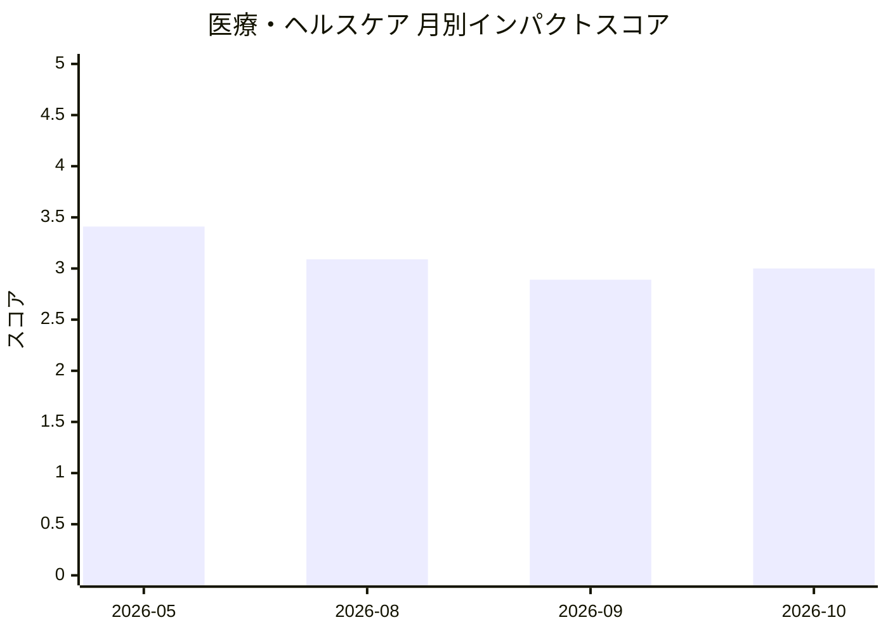

# 医療・ヘルスケア — AI活用インパクトスコア

> 最終更新: 2026-11-22 01:51 UTC | 関連記事数: 12件

## AIインパクト概要

# 医療・ヘルスケア分野へのAIインパクト分析

## 主要トレンド

医療・ヘルスケア分野では、**臨床医が介在する(Clinician-in-the-Loop)AI支援システム**が注目を集めています。特に言語聴覚療法のような専門的治療において、AIが治療プランの提案や進捗評価を支援しながらも、最終判断は医療専門家が行う「人間中心設計」が重視されています。

また、**大規模言語モデル(LLM)とエージェント型AI(自律的に複数のタスクを実行できるAI)の組み合わせ**により、診断支援や治療計画の立案など、複雑な医療判断プロセスの自動化が進んでいます。さらに**5次元マルチタスク分析フレームワーク**のような高度な分析手法により、医療画像診断や患者データの統合解析が飛躍的に向上し、より精密な個別化医療の実現が期待されています。

これらの技術は医療従事者の負担軽減と診断精度の向上を両立させ、医療アクセスの地域格差解消にも貢献する可能性があります。

## 月別インパクトスコア推移

| 月 | 関連記事数 | 平均スコア |
|-----|-----------|-----------|
| 2026-10 | 2件 | 3.00 |
| 2026-09 | 4件 | 2.89 |
| 2026-08 | 5件 | 3.09 |
| 2026-05 | 1件 | 3.41 |

## 注目記事 TOP3

### 1. [Virtual Speech Therapist: A Clinician-in-the-Loop AI Sp](https://arxiv.org/abs/2605.01101)
**3.4 ★★★☆☆** | arXiv cs.AI | 2026-05-06

（APIキー未設定のためモックスコアを使用）

### 2. [Standalone LLM and a Pre-specified Agentic Pipeline for](https://arxiv.org/abs/2608.26109)
**3.3 ★★★☆☆** | arXiv cs.AI | 2026-08-28

（スコアリングAPIエラー）

### 3. [Methodological and Conceptual Framework for 5D Multi-Ta](https://arxiv.org/abs/2608.26149)
**3.3 ★★★☆☆** | arXiv cs.AI | 2026-08-29

（スコアリングAPIエラー）

---
*本ページは ai-research システムにより自動生成されました。*