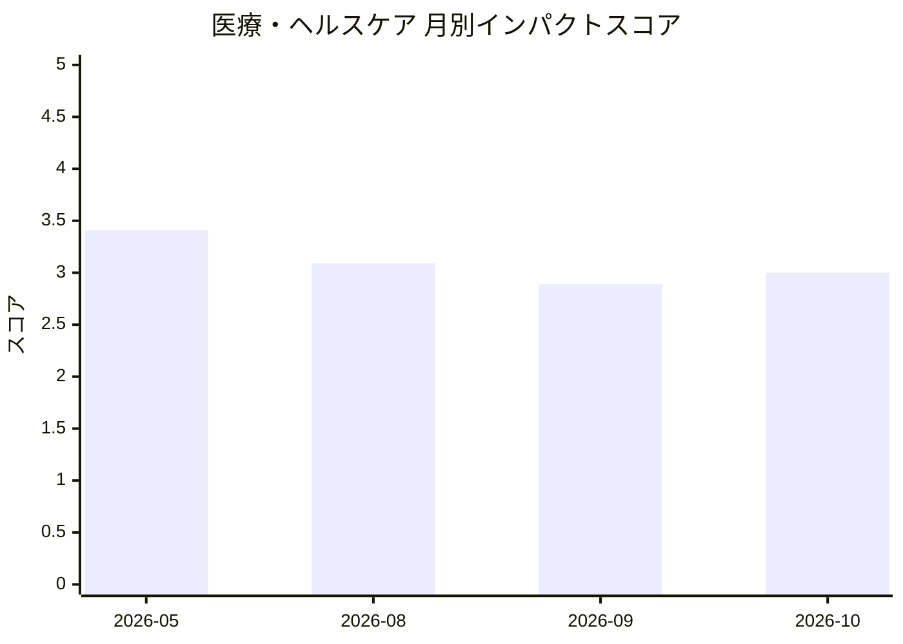

# 医療・ヘルスケア — AI活用インパクトスコア

> 最終更新: 2026-10-24 23:55 UTC | 関連記事数: 12件

## AIインパクト概要

# 医療・ヘルスケア分野へのAIインパクト分析

## 主要トレンド

医療・ヘルスケア分野では、**臨床現場を支援するAIシステム**が急速に進化しています。特に注目すべきは「Clinician-in-the-Loop」(臨床医が介在するループ型AI)アプローチで、AIが単独で診断・治療を行うのではなく、医療専門家の判断を支援・補完する形で統合されています。

音声言語療法の分野では、バーチャル音声セラピストのような**患者の自主トレーニングを支援するAI**が登場し、医療リソースの制約を補完しながら、リハビリテーションの継続性を高める可能性を示しています。また、大規模言語モデル(LLM)を活用した診断支援システムは、複雑な医療データの分析と意思決定プロセスの透明性向上に貢献しています。

さらに、5次元マルチタスク解析のような**高度な医療画像解析技術**により、従来は困難だった複数の臨床指標を同時評価できるようになり、より包括的で精緻な診断が可能となっています。これらの技術は、医療の質向上と効率化の両立を実現する重要な

## 月別インパクトスコア推移

| 月 | 関連記事数 | 平均スコア |
|-----|-----------|-----------|
| 2026-10 | 2件 | 3.00 |
| 2026-09 | 4件 | 2.89 |
| 2026-08 | 5件 | 3.09 |
| 2026-05 | 1件 | 3.41 |

## 注目記事 TOP3

### 1. [Virtual Speech Therapist: A Clinician-in-the-Loop AI Sp](https://arxiv.org/abs/2605.01101)
**3.4 ★★★☆☆** | arXiv cs.AI | 2026-05-06

（APIキー未設定のためモックスコアを使用）

### 2. [Standalone LLM and a Pre-specified Agentic Pipeline for](https://arxiv.org/abs/2608.26109)
**3.3 ★★★☆☆** | arXiv cs.AI | 2026-08-28

（スコアリングAPIエラー）

### 3. [Methodological and Conceptual Framework for 5D Multi-Ta](https://arxiv.org/abs/2608.26149)
**3.3 ★★★☆☆** | arXiv cs.AI | 2026-08-29

（スコアリングAPIエラー）

---
*本ページは ai-research システムにより自動生成されました。*