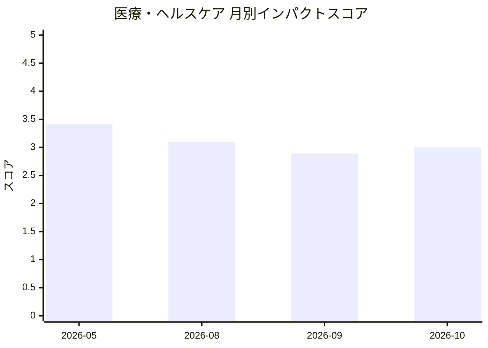

# 医療・ヘルスケア — AI活用インパクトスコア

> 最終更新: 2026-11-01 00:37 UTC | 関連記事数: 12件

## AIインパクト概要

# 医療・ヘルスケアへのAIインパクト分析

## 主要トレンド

医療・ヘルスケア分野では、**臨床医が監督する「クリニシャン・イン・ザ・ループ」型のAIシステム**が注目されており、仮想言語療法士のような専門的医療サービスの自動化・効率化が進んでいます。これにより、人手不足が深刻な専門医療分野でも、AIが初期対応や定型的な診療支援を担い、医療専門家は複雑な判断や患者ケアに集中できるようになります。

また、**LLM（大規模言語モデル）を活用したエージェント型医療システム**や、**5次元マルチタスク分析フレームワーク**など、より高度な診断支援・治療計画立案ツールの開発が加速しており、医療の質向上と医療従事者の負担軽減の両立が期待されています。ただし、医療の最終判断には必ず人間の専門家が関与する「ループ内人間」の設計思想が重視されており、安全性と説明責任の確保が前提となっています。

## 月別インパクトスコア推移

| 月 | 関連記事数 | 平均スコア |
|-----|-----------|-----------|
| 2026-10 | 2件 | 3.00 |
| 2026-09 | 4件 | 2.89 |
| 2026-08 | 5件 | 3.09 |
| 2026-05 | 1件 | 3.41 |

## 注目記事 TOP3

### 1. [Virtual Speech Therapist: A Clinician-in-the-Loop AI Sp](https://arxiv.org/abs/2605.01101)
**3.4 ★★★☆☆** | arXiv cs.AI | 2026-05-06

（APIキー未設定のためモックスコアを使用）

### 2. [Standalone LLM and a Pre-specified Agentic Pipeline for](https://arxiv.org/abs/2608.26109)
**3.3 ★★★☆☆** | arXiv cs.AI | 2026-08-28

（スコアリングAPIエラー）

### 3. [Methodological and Conceptual Framework for 5D Multi-Ta](https://arxiv.org/abs/2608.26149)
**3.3 ★★★☆☆** | arXiv cs.AI | 2026-08-29

（スコアリングAPIエラー）

---
*本ページは ai-research システムにより自動生成されました。*