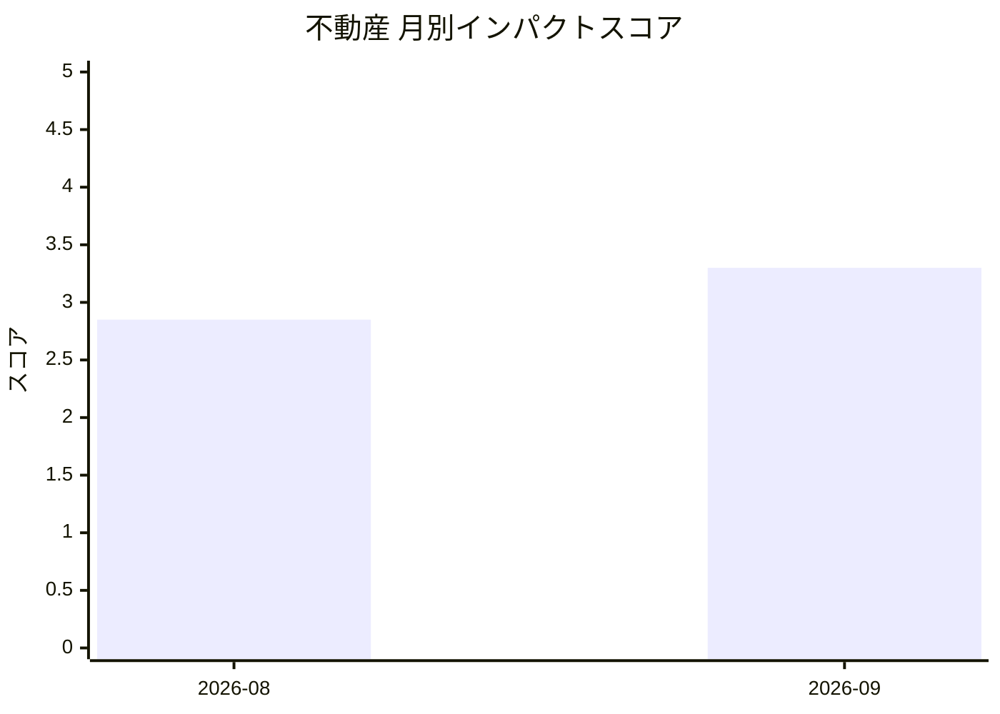

# 不動産 — AI活用インパクトスコア

> 最終更新: 2026-11-22 01:51 UTC | 関連記事数: 2件

## AIインパクト概要

# 【不動産】へのAIインパクト分析

## 現状と影響

提供された記事は不動産分野への直接的な影響を示すものではありませんが、AI技術の基盤的な進化と法的課題を示しています。

**強化学習技術の進化**（Emphatic TD学習）は、不動産価格予測や物件評価の精度向上に応用可能です。市場データから学習し、より安定的な価格予測モデルを構築できる可能性があります。

**AI企業への著作権訴訟**の事例は、不動産業界がAIを活用する際の重要な示唆を与えます。物件画像や図面、契約書類などの知的財産権の扱いに注意が必要で、AI学習データの適切な権利処理が今後の課題となるでしょう。

現時点では不動産特化型の大きな技術革新は見られませんが、AI基盤技術の成熟と法的環境の整備が進んでおり、今後の本格的なAI活用に向けた準備期にあると言えます。

## 月別インパクトスコア推移

| 月 | 関連記事数 | 平均スコア |
|-----|-----------|-----------|
| 2026-09 | 1件 | 3.30 |
| 2026-08 | 1件 | 2.85 |

## 注目記事 TOP3

### 1. [Regularized Emphatic Temporal-Difference Learning: Stab](https://arxiv.org/abs/2609.19170)
**3.3 ★★★☆☆** | arXiv cs.AI | 2026-09-18

（スコアリングAPIエラー）

### 2. [Sony Music, Warner sue Anthropic, alleging a “brazen ca](https://techcrunch.com/2026/08/29/sony-music-warner-sue-anthropic-alleging-a-brazen-campaign-of-intellectual-property-theft/)
**2.9 ★★☆☆☆** | TechCrunch AI | 2026-08-29

（スコアリングAPIエラー）

---
*本ページは ai-research システムにより自動生成されました。*