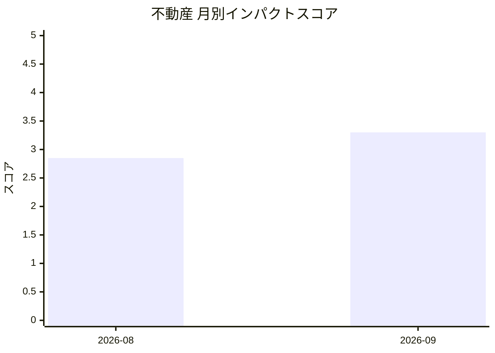

# 不動産 — AI活用インパクトスコア

> 最終更新: 2026-11-01 00:37 UTC | 関連記事数: 2件

## AIインパクト概要

# 【不動産】へのAI生成技術のインパクト分析

## 現状評価
提供された記事は、不動産業界への直接的な影響を示すものではありません。1件目は強化学習（AIが試行錯誤を通じて最適な行動を学習する技術）の理論的研究、2件目は音楽業界における著作権訴訟に関するものです。

## 不動産業界への潜在的影響
ただし、これらの技術トレンドから不動産業界への間接的な影響を推測すると、以下が考えられます。強化学習技術の進化は、不動産価格予測や最適な物件マッチング、賃料設定の自動最適化などに応用可能です。また、生成AIをめぐる著作権問題は、不動産業界でも物件説明文や広告画像の自動生成を導入する際に、同様の法的リスクを考慮する必要性を示唆しています。現時点では不動産業界への直接的なインパクトを示す記事が不足しているため、より具体的な分析には業界特化の情報収集が必要です。

## 月別インパクトスコア推移

| 月 | 関連記事数 | 平均スコア |
|-----|-----------|-----------|
| 2026-09 | 1件 | 3.30 |
| 2026-08 | 1件 | 2.85 |

## 注目記事 TOP3

### 1. [Regularized Emphatic Temporal-Difference Learning: Stab](https://arxiv.org/abs/2609.19170)
**3.3 ★★★☆☆** | arXiv cs.AI | 2026-09-18

（スコアリングAPIエラー）

### 2. [Sony Music, Warner sue Anthropic, alleging a “brazen ca](https://techcrunch.com/2026/08/29/sony-music-warner-sue-anthropic-alleging-a-brazen-campaign-of-intellectual-property-theft/)
**2.9 ★★☆☆☆** | TechCrunch AI | 2026-08-29

（スコアリングAPIエラー）

---
*本ページは ai-research システムにより自動生成されました。*