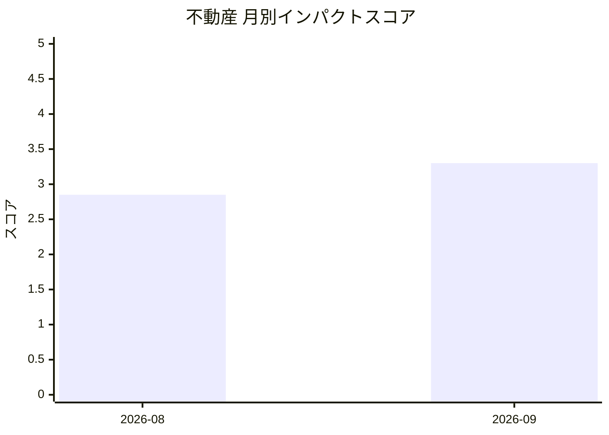

# 不動産 — AI活用インパクトスコア

> 最終更新: 2026-11-08 01:00 UTC | 関連記事数: 2件

## AIインパクト概要

# 【不動産】へのAIインパクト分析

提供された記事は不動産分野と直接的な関連性が薄いため、一般的なAI技術の不動産への影響について解説します。

## 主な影響

**物件評価の高度化**: AI技術、特に機械学習を活用することで、不動産の適正価格算定がより精緻になります。立地、築年数、市場動向などの膨大なデータを学習し、従来の人間による評価では見落としがちな価格変動要因を捉えることが可能になります。

**顧客マッチングの最適化**: 生成AIを活用したチャットボットや推薦システムにより、顧客の希望条件を自然言語で理解し、最適な物件を提案できるようになります。これにより営業効率が向上し、顧客満足度も高まります。

**契約プロセスの効率化**: AI技術による文書解析や自動チェック機能により、賃貸契約や売買契約における重要事項説明書のレビュー時間を大幅に短縮できます。ただし、著作権などの法的リスク管理は引き続き重要な課題となります。

## 月別インパクトスコア推移

| 月 | 関連記事数 | 平均スコア |
|-----|-----------|-----------|
| 2026-09 | 1件 | 3.30 |
| 2026-08 | 1件 | 2.85 |

## 注目記事 TOP3

### 1. [Regularized Emphatic Temporal-Difference Learning: Stab](https://arxiv.org/abs/2609.19170)
**3.3 ★★★☆☆** | arXiv cs.AI | 2026-09-18

（スコアリングAPIエラー）

### 2. [Sony Music, Warner sue Anthropic, alleging a “brazen ca](https://techcrunch.com/2026/08/29/sony-music-warner-sue-anthropic-alleging-a-brazen-campaign-of-intellectual-property-theft/)
**2.9 ★★☆☆☆** | TechCrunch AI | 2026-08-29

（スコアリングAPIエラー）

---
*本ページは ai-research システムにより自動生成されました。*