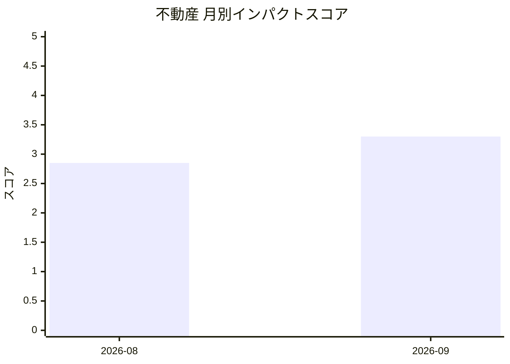

# 不動産 — AI活用インパクトスコア

> 最終更新: 2026-10-24 23:55 UTC | 関連記事数: 2件

## AIインパクト概要

# 【不動産】へのAIインパクト分析

提供された記事は、不動産業界への直接的な影響を示すものではありませんが、AI技術の基盤的な発展と法的課題に関するものです。

**技術面の影響:**
強化学習アルゴリズムの安定化に関する研究は、不動産価格予測や投資判断の精度向上に間接的に寄与する可能性があります。より安定したAIモデルは、市場変動の予測や物件評価の自動化において、信頼性の高い判断材料を提供できます。

**法的リスクへの示唆:**
音楽業界のAI著作権訴訟は、不動産業界にとっても重要な警鐘です。物件写真、間取り図、物件説明文などの著作物を学習データとして使用する生成AIサービスを導入する際は、知的財産権への配慮が不可欠となり、コンプライアンス体制の整備が求められます。

## 月別インパクトスコア推移

| 月 | 関連記事数 | 平均スコア |
|-----|-----------|-----------|
| 2026-09 | 1件 | 3.30 |
| 2026-08 | 1件 | 2.85 |

## 注目記事 TOP3

### 1. [Regularized Emphatic Temporal-Difference Learning: Stab](https://arxiv.org/abs/2609.19170)
**3.3 ★★★☆☆** | arXiv cs.AI | 2026-09-18

（スコアリングAPIエラー）

### 2. [Sony Music, Warner sue Anthropic, alleging a “brazen ca](https://techcrunch.com/2026/08/29/sony-music-warner-sue-anthropic-alleging-a-brazen-campaign-of-intellectual-property-theft/)
**2.9 ★★☆☆☆** | TechCrunch AI | 2026-08-29

（スコアリングAPIエラー）

---
*本ページは ai-research システムにより自動生成されました。*