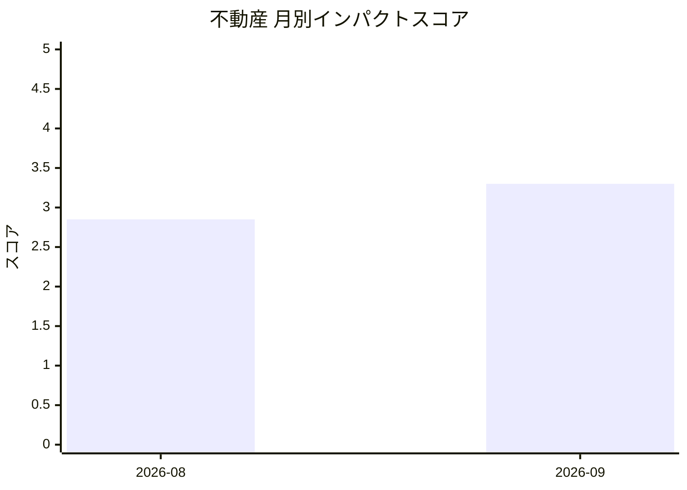

# 不動産 — AI活用インパクトスコア

> 最終更新: 2026-11-15 01:29 UTC | 関連記事数: 2件

## AIインパクト概要

# 【不動産】へのAIインパクト分析

## 現状の技術トレンド

提供された記事は、強化学習の安定化技術と音楽業界でのAI著作権訴訟に関するものであり、不動産分野への直接的な影響は限定的です。

## 不動産分野への潜在的影響

ただし、強化学習技術の安定化は、不動産価格予測や投資ポートフォリオ最適化（複数の物件への投資配分を最適化すること）への応用可能性があります。AI著作権問題の動向は、不動産マーケティングにおけるAI生成コンテンツ利用時の法的リスク管理に影響を与える可能性があります。現時点では、物件検索の最適化や賃料予測など、不動産特有のAI活用事例との関連性は薄いと言えます。

## 月別インパクトスコア推移

| 月 | 関連記事数 | 平均スコア |
|-----|-----------|-----------|
| 2026-09 | 1件 | 3.30 |
| 2026-08 | 1件 | 2.85 |

## 注目記事 TOP3

### 1. [Regularized Emphatic Temporal-Difference Learning: Stab](https://arxiv.org/abs/2609.19170)
**3.3 ★★★☆☆** | arXiv cs.AI | 2026-09-18

（スコアリングAPIエラー）

### 2. [Sony Music, Warner sue Anthropic, alleging a “brazen ca](https://techcrunch.com/2026/08/29/sony-music-warner-sue-anthropic-alleging-a-brazen-campaign-of-intellectual-property-theft/)
**2.9 ★★☆☆☆** | TechCrunch AI | 2026-08-29

（スコアリングAPIエラー）

---
*本ページは ai-research システムにより自動生成されました。*